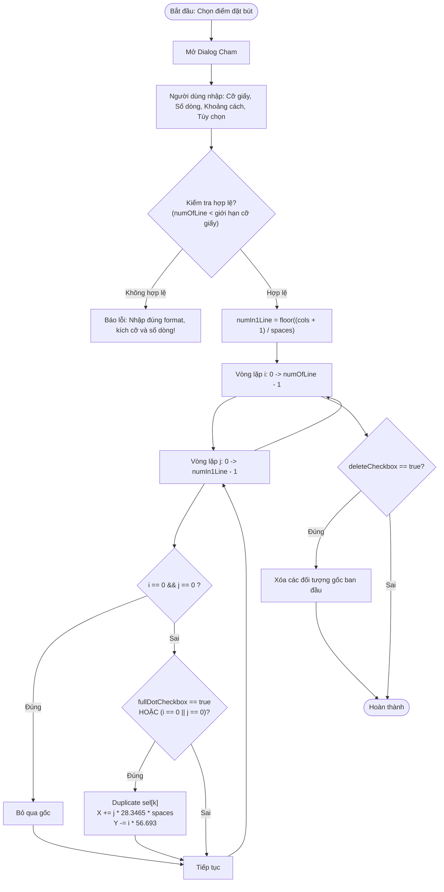

# Cham - Illustrator Dot Duplication Script Logic

Tài liệu giải thích thuật toán, thông số kỹ thuật và logic hoạt động của script Adobe Illustrator `Cham.jsx` dùng để tạo các điểm chấm hướng dẫn đặt bút (điểm bắt đầu viết glyph / chữ mẫu) trong vở tập viết ô ly tiểu học.

---

## 1. Mục đích & Quy trình Sử dụng (Workflow)

Trong dạy tập viết cho học sinh tiểu học:
1. Giáo viên / người thiết kế đặt trước một hoặc nhiều điểm chấm (guide dot) tại vị trí đặt bút đầu tiên của chữ mẫu (glyph).
2. Chọn (select) điểm chấm vừa tạo trong Adobe Illustrator.
3. Chạy script `Cham.jsx`:
   - Chọn cỡ trang giấy (`To` hoặc `Bé`).
   - Nhập số dòng (`Số dòng`) và khoảng cách giữa các chữ (`Khoảng cách` - tính theo số ô ly/block).
   - Tùy chọn chấm toàn bộ hay chỉ chấm dòng đầu và đầu mỗi dòng tiếp theo.
4. Script tự động nhân bản (duplicate) điểm chấm qua các cột và dòng theo đúng lưới ô ly chuẩn.

---

## 2. Thông số & Hệ tọa độ Hình học

### 2.1. Đơn vị đo trong Adobe Illustrator
- Trong Illustrator, đơn vị đo cơ bản là **Point (pt)**:
  $$\text{1 cm} = \frac{72\text{ pt}}{2.54} \approx 28.3465\text{ pt}$$
- **Bước ngang 1 ô (Block Width)**: `28.3465 pt` $\approx 10\text{ mm}$ (kích thước 1 ô vuông lớn chuẩn trong tập viết).
- **Bước dọc 1 dòng (Line Height)**: `56.693 pt` $= 2 \times 28.3465\text{ pt} = 20\text{ mm}$ (mỗi dòng cách nhau 2 ô vuông lớn / 2 cm).
- Trục tọa độ Illustrator:
  - Trục $X$: Chiều dương sang phải $\rightarrow \text{pos}[0] + j \times 28.3465 \times \text{spaces}$.
  - Trục $Y$: Chiều âm đi xuống dưới $\rightarrow \text{pos}[1] - i \times 56.693$.

### 2.2. Cấu hình Cỡ giấy (Paper Sizes)
| Cỡ giấy | Kích thước lưới `[cols, rows]` | Giới hạn số dòng tối đa (`numOfLine`) |
| :--- | :--- | :--- |
| **Bé** (`smallSelection`) | `[14, 20]` (14 cột, 20 ô) | $< 11$ dòng (tối đa 10 dòng) |
| **To** (`bigSelection`) | `[17, 27]` (17 cột, 27 ô) | $< 14$ dòng (tối đa 13 dòng) |

---

## 3. Thuật toán Chi tiết (Algorithm)

### 3.1. Tính số điểm trên 1 dòng
$$\text{numIn1Line} = \left\lfloor \frac{\text{size}[0] + 1}{\text{spaces}} \right\rfloor$$

- `size[0]` là số cột ngang của trang (14 với cỡ Bé, 17 với cỡ To).
- `spaces`: Số ô cách nhau giữa 2 điểm liên tiếp trên cùng dòng.

### 3.2. Điều kiện lặp và phân bổ điểm chấm
Script sử dụng 2 vòng lặp lồng nhau:
- Vòng ngoài: $i = 0 \to \text{numOfLine} - 1$ (theo từng dòng).
- Vòng trong: $j = 0 \to \text{numIn1Line} - 1$ (theo từng cột trên dòng).

**Quy tắc vị trí:**
1. **Bỏ qua gốc ban đầu:**
   Khi $i = 0$ và $j = 0$, không tạo thêm bản sao đè lên vị trí gốc.
2. **Chế độ Chấm (`fullDotCheckbox`):**
   - **Nếu chọn `Chấm hết` (`fullDotCheckbox = true`):**
     Nhân bản tại tất cả các ô $(i, j)$.
   - **Nếu không chọn `Chấm hết` (`fullDotCheckbox = false`):**
     Chỉ nhân bản khi $i = 0$ (toàn bộ dòng đầu) **hoặc** $j = 0$ (chỉ chấm đầu mỗi dòng tiếp theo để học sinh tự căn khoảng cách phần còn lại).
3. **Tọa độ bản sao mới:**
   $$\begin{cases} X_{\text{new}} = X_{\text{gốc}} + j \times 28.3465 \times \text{spaces} \\ Y_{\text{new}} = Y_{\text{gốc}} - i \times 56.693 \end{cases}$$

### 3.3. Dọn dẹp đối tượng gốc (`deleteCheckbox`)
- Nếu `deleteCheckbox = true`: Xóa các đối tượng ban đầu được chọn sau khi nhân bản xong.

---

## 4. Sơ đồ Luồng Hoạt động (Flowchart)

---

## 5. Ứng dụng vào Dự án Web (Vietnamese Handwriting Generator)

Logic này có thể chuyển thể trực tiếp lên giao diện Web (HTML5 Canvas / SVG / DOM) của dự án:
- **Tọa độ lưới tương đương**:
  Thay vì `28.3465 pt`, dùng kích thước ô ly tính theo pixel trên canvas/web (`cellSize` hoặc `gridStep`).
- **Chế độ bài tập**:
  1. Hàng 1: Viết mẫu + chấm điểm đặt bút đầy đủ.
  2. Hàng tiếp theo: Chỉ chấm điểm đặt bút đầu dòng (tương ứng `!fullDotCheckbox`).
  3. Cho phép người dùng chỉnh `spaces` (ví dụ cách nhau 2 ô, 3 ô, 4 ô) để học sinh viết các từ ngắn hoặc dài.
